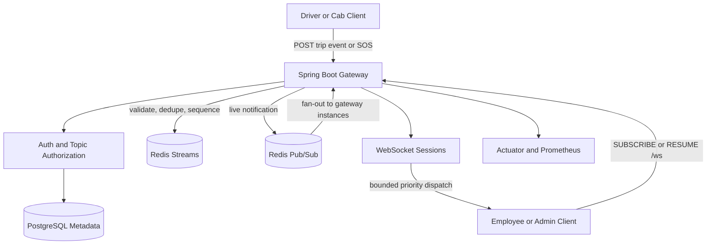
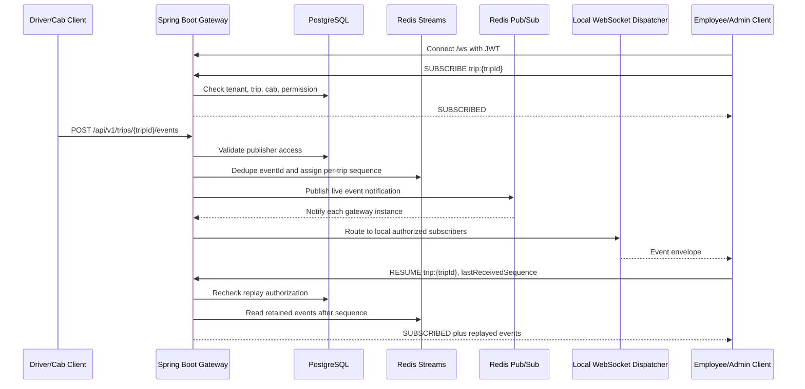

# Live Trip Updates

Real-time trip update fan-out service built with Java 21, Spring Boot,
PostgreSQL, Redis Streams, Redis Pub/Sub, and WebSockets.

## Architecture



The service is a modular monolith that can run as multiple identical gateway
instances. PostgreSQL stores business metadata and permissions, Redis Streams
stores replayable per-trip event history, and Redis Pub/Sub carries live
notifications between gateway instances.

## Workflow



Main flow:

1. A client authenticates with JWT and subscribes to a trip topic over `/ws`.
2. The gateway checks topic syntax and authorization against PostgreSQL.
3. A cab or driver publishes an event through the REST API.
4. The gateway validates the payload, rejects unauthorized access, and resolves
   tenant/cab details from server-side metadata.
5. Redis assigns the next per-trip sequence and stores the event in a Stream.
6. Redis Pub/Sub broadcasts a live notification to all gateway instances.
7. Each gateway fans out only to its local authorized WebSocket subscribers.
8. Slow clients are protected by bounded outbound queues and recover with replay.
9. SOS events use critical priority dispatch and remain replayable.

## Local Development

### One-Command Run

The entire stack (Spring Boot gateway, PostgreSQL, Redis, and Prometheus) starts with a single command:

```bash
docker compose up --build
```

Run tests through Docker when Java and Maven are not installed locally:

```bash
docker run --rm -v "$PWD":/workspace -v live-trip-m2:/root/.m2 -w /workspace maven:3.9.9-eclipse-temurin-21 mvn test
```

Health endpoint:

```bash
curl http://localhost:8080/actuator/health
```

Prometheus metrics:

```bash
curl http://localhost:8080/actuator/prometheus
```

## Benchmark Results

Load tests executed with `grafana/k6` across varying concurrency tiers to evaluate throughput and latency against the Case Study SLA (< 2.0s for SOS delivery):

| Tier | Throughput | WS Fan-Out Delivered | Ingestion p50 | Ingestion p99 | WS Connect p99 | SLA Target (< 2s) |
| :---: | :---: | :---: | :---: | :---: | :---: | :---: |
| **1 VU (Baseline)** | 0.45 req/s | 14 msgs | 62.7 ms | 868.3 ms | 59.2 ms | **PASS** ✅ |
| **100 VUs** | 45.5 req/s | 28,237 msgs | 58.7 ms | 503.7 ms | 107.8 ms | **PASS** ✅ |
| **500 VUs** | 201.4 req/s | 515,247 msgs | 66.1 ms | 1.05 s | 370.8 ms | **PASS** ✅ |
| **750 VUs (Stable Max)** | **270.0 req/s** | **815,046 msgs** | **143.3 ms** | **1.15 s** | **697.0 ms** | **PASS** ✅ |
| **10,000 VUs (Stress)** | 99.2 req/s | 8,723 msgs | 6.33 s | 24.99 s | 24.49 s | Saturated (Backlog) |

*Full details, hardware environment, and analysis available in [docs/benchmarks.md](docs/benchmarks.md).*

## Implemented Surface

- Authenticated REST ingestion: `POST /api/v1/trips/{tripId}/events`
- SOS ingestion: `POST /api/v1/trips/{tripId}/sos`
- Event history: `GET /api/v1/trips/{tripId}/events`
- WebSocket subscriptions and trip replay: `/ws`
- Redis Streams for retained events and Redis Pub/Sub for live fan-out
- Per-trip sequencing, event-ID idempotency, duplicate conflict detection
- Bounded WebSocket outbound queues with critical priority dispatch

## Configuration

Important environment variables:

- `SPRING_DATASOURCE_URL`
- `SPRING_DATASOURCE_USERNAME`
- `SPRING_DATASOURCE_PASSWORD`
- `SPRING_DATA_REDIS_HOST`
- `SPRING_DATA_REDIS_PORT`
- `JWT_DEV_SECRET`
- `WEBSOCKET_ALLOWED_ORIGIN_PATTERNS`
- `WEBSOCKET_OUTBOUND_QUEUE_CAPACITY`
- `EVENT_STREAM_MAX_LENGTH`
- `EVENT_IDEMPOTENCY_TTL_SECONDS`
- `EVENT_REPLAY_MAX_BATCH_SIZE`

## Current Limits

The service does not yet include trip snapshots, ACK tracking, location
conflation, or permission-revocation fan-out.
Those are documented follow-up phases rather than hidden behavior.
