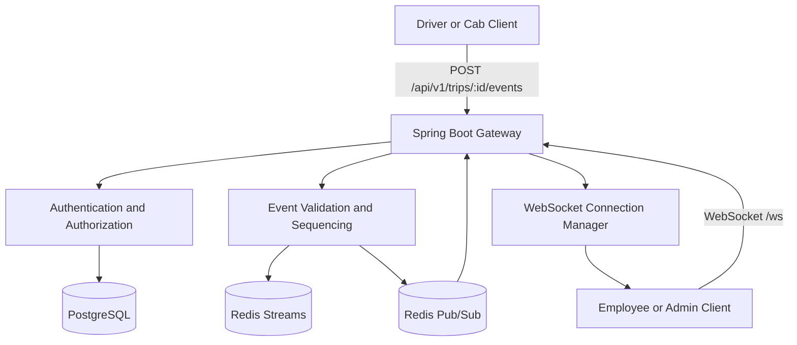

# Architecture

## Goal

Live Trip Updates distributes cab and trip lifecycle events to authorized
employees and transport administrators over WebSockets. The implementation is a
Java 21 Spring Boot modular monolith that can run as multiple identical gateway
instances behind a load balancer.

The first release favors correctness and operability over extra infrastructure:
no separate microservices, Kafka, Kubernetes, service mesh, or external API
gateway are required.

## System Diagram

## Runtime Responsibilities

PostgreSQL stores durable business metadata: tenants, users, cabs, trips, and
permissions. It is not the high-volume event log in the initial design.

Redis Streams stores replayable trip events with per-trip sequence numbers.
Clients use replay when they reconnect or miss live notifications.

Redis Pub/Sub distributes low-latency live notifications to all running gateway
instances. Pub/Sub is not used as event history because it does not retain
messages for disconnected subscribers.

Gateway memory stores only local WebSocket sessions, local subscriptions, and
bounded outbound queues. This state is rebuilt when clients reconnect.

## Event Flow

1. A publisher sends a trip event to a protected REST endpoint.
2. The server authenticates the caller and checks trip/cab authorization.
3. The server validates the event type and payload.
4. The event receives a stable event ID and a per-trip sequence number.
5. The event is appended to Redis Streams before it is considered accepted.
6. A live notification is published through Redis Pub/Sub.
7. Each gateway receives the notification and routes it to local subscribers.
8. Each client connection uses a bounded outbound dispatcher.
9. A reconnecting client sends its last processed sequence and replays retained
   events before returning to live delivery.

## Ordering and Delivery Semantics

Ordering is guaranteed within a trip stream only. The system does not promise
global ordering across trips.

The system does not claim exactly-once delivery. It uses stable event IDs,
per-trip sequence numbers, idempotent ingestion, replay, and duplicate
suppression to give clients a recoverable at-least-once live delivery model.

The current dispatcher uses bounded queues and closes slow clients when queues
overflow, relying on replay for recovery. SOS events use a critical priority
lane and are drained before normal events. Location conflation is a planned
follow-up and is not claimed as implemented yet.

## Security Model

Every protected REST API, WebSocket subscription, replay request, and publish
operation requires authentication.

Tenant ID, trip ID, cab ID, and office scope are verified against trusted
server-side records. Client-provided topic strings are treated as requests, not
proof of permission.

Management endpoints expose health and Prometheus metrics for local development.
Production deployments should secure or isolate the management interface.

## Operational Notes

The service reads configuration from environment variables. Docker Compose starts
PostgreSQL, Redis, and the application for local development.

Metrics should avoid high-cardinality labels such as user ID, trip ID, cab ID,
or connection ID. Logs should avoid secrets, JWTs, precise location payloads,
and personal data.

Implemented counters include accepted, rejected, duplicate, replayed, and
delivered trip events. They are exposed through the Spring Boot Prometheus
actuator endpoint.
